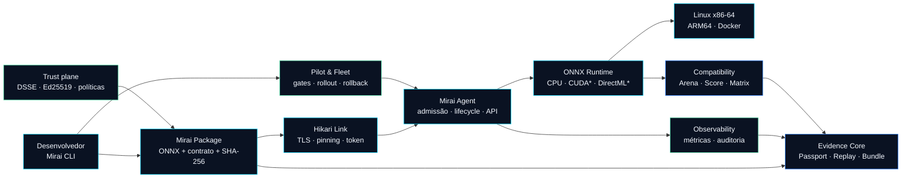

<div align="center">


<br>

[](https://github.com/start6202783-dotcom/MiraiOS/actions/workflows/ci.yml)
[](https://pypi.org/project/miraios/)
[](pyproject.toml)
[](LICENSE)
[](#maturidade-e-limites)

**Infraestrutura local-first para implantar, executar, observar e recuperar IA
verificável em dispositivos locais.**

[Começar](#comece-em-3-minutos) ·
[Demonstração](#da-inferência-à-evidência) ·
[Capacidades](#o-que-a-v014-entrega) ·
[Arquitetura](#arquitetura) ·
[Documentação](#documentação) ·
[Contribuir](CONTRIBUTING.md)

</div>

---

## MiraiOS em uma frase

O **MiraiOS** é uma camada operacional open-source para levar modelos ONNX do
computador de desenvolvimento até dispositivos Edge com identidade de
artefato, deploy controlado, inferência, métricas, evidências e rollback.

Ele não é uma distribuição Linux, não é um serviço de nuvem e não é mais um
servidor genérico para LLMs. A tese do projeto é específica: **IA no mundo
físico precisa ser verificável quando funciona e recuperável quando falha.**


| Sem MiraiOS | Com MiraiOS |
| --- | --- |
| Modelo, parâmetros e scripts separados | Pacote `.mirai` reproduzível com contrato verificável |
| Upload tratado como implantação | Admissão, deploy, ativação e teste são etapas explícitas |
| Benchmark isolado e difícil de comparar | Medição padronizada ligada ao artefato e ao hardware |
| Falha descoberta depois da troca | Critérios executáveis e rollback para o estado anterior |
| Logs soltos como prova | Passport, Replay e Evidence Bundle verificáveis por digest |

## Da inferência à evidência

A v0.14 fecha o ciclo entre o modelo executado e a prova portátil do que foi
validado. A animação usa comandos disponíveis na CLI atual; os valores exibidos
são demonstrativos e não alegam benchmark de um hardware específico.

<div align="center">


</div>

```text
modelo ONNX
   └── pacote .mirai + identidade
         ├── deploy e inferência local/remota
         ├── benchmark + compatibilidade
         ├── replay + teste de falhas
         └── Evidence Bundle verificável
```

## Comece em 3 minutos

Você pode provar o protocolo no próprio computador. Não é necessário comprar
uma placa para começar.

### 1. Instale a v0.14 do repositório

O MiraiOS requer Python 3.10 ou superior:

```bash
git clone https://github.com/start6202783-dotcom/MiraiOS.git
cd MiraiOS
python -m venv .venv
source .venv/bin/activate
python -m pip install --editable .
```

No Windows PowerShell, use `.venv\Scripts\Activate.ps1` para ativar o ambiente.
A versão publicada no PyPI pode ficar temporariamente atrás da branch `main`;
o badge no topo mostra a série disponível. Para contribuir, consulte o
[guia de contribuição](CONTRIBUTING.md).

### 2. Inicie um Agent local

No primeiro terminal:

```bash
mirai agent start
```

O endereço padrão é `http://127.0.0.1:8080`. Localhost dispensa pareamento
porque o Agent não aceita conexões de outra máquina nesse modo.

### 3. Empacote e execute

No segundo terminal:

```bash
python scripts/create_dummy_model.py
mirai pack examples/dummy_model.onnx \
  --name dummy \
  --package-version 1.0.0
mirai device add local --url http://127.0.0.1:8080
mirai launch dummy-1.0.0.mirai --device local --input 5.0
```

O modelo de exemplo soma `1` à entrada. O resultado esperado é `6.0`. O
`launch` valida o artefato e o dispositivo, faz deploy, ativa e testa; se o
teste final falhar, a ativação anterior é restaurada.

> Quer testar sem instalar o Python no dispositivo? Use o
> [Agent em Docker](docs/getting-started.md#agent-em-docker).

## O que a v0.14 entrega

O projeto já reúne o caminho básico de execução e uma camada de confiança
operacional. Cada capacidade abaixo possui implementação, testes e contrato
documentado; as limitações continuam explícitas.

| Camada | Capacidade | Resultado |
| --- | --- | --- |
| **Package** | Manifesto estrito, contrato e SHA-256 | Artefato `.mirai` reproduzível |
| **Hikari Link** | TLS, fingerprint e token por cliente | Canal pareável em rede privada |
| **Shield** | Assinatura, admissão e quarentena ONNX | Pacote recusado antes do runtime quando viola a política |
| **Pilot** | Critérios, benchmark e rollback | Entrega repetível com relatório JSON/Markdown |
| **Fleet** | Tags, canário, lotes e gates | Rollout progressivo; simulação por padrão |
| **Observability** | Métricas, Prometheus e auditoria | Estado operacional sem persistir entradas brutas |
| **Fit** | Dynamic INT8 com comparação e gates | Variante publicada somente quando aprovada |
| **Evidence** | Passport, Replay e Bundle | Identidade e reprodução portáteis por digest |
| **Compatibility** | Arena Result, Edge Score e Matrix | Desempenho comparável por workload e SLA |
| **Failure Lab** | Falhas em cópias temporárias | Evidência de detecção e repetibilidade |

### O marco da v0.14

```text
identificar → capturar → medir → verificar → agregar → compartilhar
```

- **Model Passport:** declara identidade, contrato, origem, precisão, uso
  pretendido e limites do modelo.
- **Mirai Replay:** captura uma inferência somente com consentimento explícito
  e compara uma nova execução com tolerância definida.
- **Evidence Bundle:** reúne relatório, assinatura, Passport e anexos por
  digest sem incluir o modelo por padrão.
- **Arena Core:** produz resultado single-stream padronizado com P95, P99,
  estabilidade, IPS e identidade de hardware sem hostname, rede ou serial.
- **Edge Score:** responde se um resultado atende a um SLA declarado; não cria
  um número universal de marketing.
- **Compatibility Matrix:** organiza medições locais e registra o nível de
  evidência de cada combinação.
- **Failure Lab:** injeta corrupção e truncamento apenas em cópias temporárias;
  não é sandbox nem fuzzer.

Veja os schemas, comandos e garantias em
[Projeto Hikari v0.14](docs/hikari-v0.14.md).

## Arquitetura



`*` Os perfis CUDA e DirectML podem ser selecionados, mas a validação pública
atual é mais forte em CPU. ARM64 Linux/CPU possui job nativo no CI.

### Dois lados, responsabilidades claras

| Control plane | Dispositivo Edge |
| --- | --- |
| Empacota, assina e registra destinos | Mantém identidade e clientes pareados |
| Define pilotos, critérios e rollout | Admite e instala conteúdo validado |
| Agrega métricas e evidências | Executa e revalida antes do uso |
| Ancora checkpoints fora do Agent | Mantém lifecycle e auditoria local |

Essa separação reduz acoplamento com fabricante: o primeiro destino pode ser
localhost ou Docker; depois, o mesmo protocolo pode chegar a um SBC ARM64 ou
outro Linux compatível.

## Fluxos principais

### Piloto com critérios e rollback

```bash
mirai pilot init
mirai pilot run
```

O Pilot executa diagnóstico, deploy, ativação, health check, benchmark e
critérios de aceite. O resultado fica em `.mirai/reports/`; se uma etapa
falhar, o deployment anterior é restaurado. Veja o
[guia operacional](docs/operations.md#mirai-pilot).

### Evidência e compatibilidade

```bash
mirai passport create dummy-1.0.0.mirai \
  --output model-passport.json \
  --intended-use "teste local"

mirai arena run dummy-1.0.0.mirai \
  --output benchmark.json \
  --category sbc-arm \
  --runs 100 \
  --warmup 5

mirai arena score benchmark.json \
  --target-p95-ms 20 \
  --target-ips 50

mirai compatibility add benchmark.json
```

Para replay, Evidence Bundle e Failure Lab, siga o
[fluxo completo da v0.14](docs/hikari-v0.14.md).

### Dispositivo na rede

No dispositivo:

```bash
mirai agent start --host 0.0.0.0 --pairing-role operator
```

Na máquina do operador, confira presencialmente o código e o fingerprint
exibidos pelo Agent antes de parear:

```bash
mirai device pair edge \
  --url https://192.168.1.40:8080 \
  --code CODIGO-EXIBIDO \
  --fingerprint SHA256-EXIBIDO

mirai doctor --device edge
```

Detalhes sobre papéis, revogação, descoberta e política assinada estão no
[guia de segurança e operação](docs/operations.md).

## Comandos essenciais

| Objetivo | Comando |
| --- | --- |
| Empacotar | `mirai pack modelo.onnx --name app --package-version 1.0.0` |
| Validar | `mirai validate ARQUIVO` |
| Inspecionar | `mirai info ARQUIVO` |
| Executar | `mirai run ARQUIVO --input 5` |
| Medir | `mirai benchmark ARQUIVO` |
| Implantar em um fluxo | `mirai launch ARQUIVO --device edge --input 5` |
| Executar piloto | `mirai pilot run` |
| Diagnosticar dispositivo | `mirai doctor --device edge` |
| Criar Passport | `mirai passport create ARQUIVO --output passport.json` |
| Capturar Replay | `mirai replay capture ARQUIVO --capture-inputs ...` |
| Medir para Arena | `mirai arena run ARQUIVO --output resultado.json` |
| Testar falhas | `mirai failure-lab ARQUIVO --output resultado.json` |
| Reunir evidências | `mirai evidence create RELATORIO --output entrega.mirai-evidence` |

Execute `mirai COMANDO --help` para ver opções. A referência organizada por
tarefa está em [docs/cli-reference.md](docs/cli-reference.md).

## Segurança por desenho

O MiraiOS aplica confiança em camadas:

1. **Identidade:** pacote e modelo são identificados pelo conteúdo.
2. **Canal:** conexões fora de localhost usam HTTPS, fingerprint fixado e
   token revogável por cliente.
3. **Admissão:** a política `signed` exige DSSE/Ed25519 por chave confiável.
4. **Quarentena:** ONNX recebe verificação estrutural e limites antes do
   runtime.
5. **Integridade em uso:** arquivos instalados são revalidados antes de
   ativação e inferência.
6. **Auditoria:** eventos formam uma cadeia SHA-256 com checkpoint durável e
   ancoragem opcional fora do Agent.
7. **Recuperação:** gates e rollback impedem que uma tentativa reprovada
   substitua silenciosamente o estado conhecido.

Leia o [modelo de ameaças](docs/threat-model.md) antes de operar fora de
localhost. Vulnerabilidades devem seguir [SECURITY.md](SECURITY.md), nunca uma
issue pública com detalhes sensíveis.

## Maturidade e limites

O MiraiOS v0.14 está em **alpha**. Ele foi desenhado para laboratório,
localhost e redes privadas controladas.

| Funciona hoje | Não é prometido pela v0.14 |
| --- | --- |
| Inferência ONNX local e remota | Exposição direta do Agent à internet |
| Linux x86-64, Docker e CI ARM64 nativo | Um sistema operacional Linux completo |
| Pacote, assinatura, admissão e auditoria | Sandbox de processo, seccomp ou antivírus |
| Pilot, rollout, observabilidade e rollback | Control plane SaaS multi-tenant |
| Evidence, Replay e resultados locais da Arena | Ranking público ou certificação automática |
| Dynamic INT8 com gates no control plane | Otimização universal para todo modelo/hardware |
| TLS com pinning e autenticação por cliente | mTLS, autoridade certificadora ou cofre de chaves |

Replay pode conter dados brutos e deve receber proteção equivalente à entrada
original. A assinatura prova a chave e os bytes, não a identidade física do
hardware nem a veracidade externa da medição.

## Documentação

### Começar e operar

- [Primeiros passos e Docker](docs/getting-started.md)
- [Referência da CLI por tarefa](docs/cli-reference.md)
- [Operação, segurança, frota e evidências](docs/operations.md)
- [Modelo de ameaças](docs/threat-model.md)
- [Política de segurança](SECURITY.md)
- [Código de Conduta](CODE_OF_CONDUCT.md)
- [Como contribuir](CONTRIBUTING.md)

### Contratos de engenharia — Projeto Hikari

| Marco | Tema | Documento |
| --- | --- | --- |
| v0.6–v0.8 | Agent, lifecycle e Hikari Link | [v0.6](docs/hikari-v0.6.md) · [v0.7](docs/hikari-v0.7.md) · [v0.8](docs/hikari-v0.8.md) |
| v0.9–v0.10 | Mirai Package e Pilot | [v0.9](docs/hikari-v0.9.md) · [v0.10](docs/hikari-v0.10.md) |
| v0.11–v0.12 | Trust, Fleet, Secure Inputs e Shield | [v0.11](docs/hikari-v0.11.md) · [v0.12](docs/hikari-v0.12.md) |
| v0.13 | Fleet Control, ancoragem, observabilidade e Fit | [v0.13](docs/hikari-v0.13.md) |
| **v0.14** | **Passport, Replay, Evidence, Arena, Matrix e Failure Lab** | **[v0.14](docs/hikari-v0.14.md)** |

Consulte também o [changelog completo](CHANGELOG.md), a
[pesquisa do Mirai Shield](docs/research/0001-mirai-shield.md) e a
[pesquisa de evidência e benchmark](docs/research/0002-evidence-benchmark.md).

## Qualidade e contribuição

O CI executa **1.403 testes** em Python 3.10–3.13 no Linux x86-64, repete a
suíte em Linux ARM64 nativo e aplica lint, tipos, análise de segurança,
auditoria de dependências, cobertura de branches e build do pacote.

Contribuições úteis incluem correções, testes, documentação, resultados em
hardware real e casos negativos de segurança. Antes de abrir um PR, leia
[CONTRIBUTING.md](CONTRIBUTING.md).

Os ativos visuais são regenerados com:

```bash
python scripts/render_readme_assets.py
```

A arte-base do hero fica em `docs/assets/miraios-hero-background.jpg`; logotipo,
versão, tipografia, cards e GIF são compostos deterministicamente pelo script.

## Licença

Distribuído sob a [licença MIT](LICENSE).

<div align="center">


The Future Runs Local

</div>
