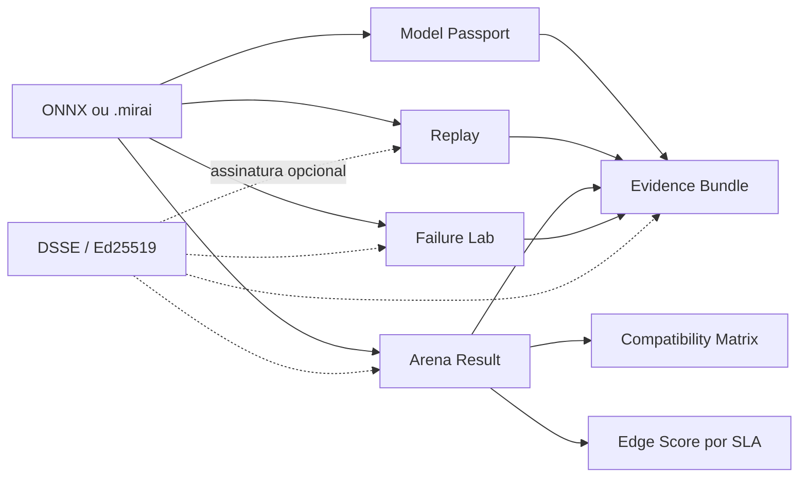

# Projeto Hikari v0.14 — Evidência, reprodução e compatibilidade

## Resumo executivo

A v0.14 transforma medições e relatórios locais em contratos portáteis que
podem ser verificados por outra pessoa. O objetivo é responder, com dados, a
cinco perguntas:

1. **qual artefato foi usado?** — Model Passport;
2. **é possível repetir a mesma inferência?** — Mirai Replay;
3. **quais provas acompanham a entrega?** — Evidence Bundle;
4. **como esse workload se comportou neste hardware?** — Arena Result e
   Compatibility Matrix;
5. **o artefato resiste a falhas básicas controladas?** — Failure Lab.

O fluxo completo é local-first:

```text
identificar → capturar → medir → verificar → agregar → compartilhar
```

Nenhum comando envia dados para a internet. A v0.14 fornece o núcleo aberto
para uma Benchmark Arena futura, mas não inclui servidor público, conta,
upload automático, moderação de resultados ou certificação comercial.

## Fluxo de evidência



Cada identidade usa SHA-256 sobre bytes estáveis. Arquivos JSON são
decodificados de forma estrita, sem chaves duplicadas, números não finitos ou
estruturas acima dos limites globais. Evidence Bundle e Replay usam escrita
atômica e permissões `0600` quando o sistema operacional permite.

## 1. Model Passport

O passaporte descreve o artefato sem inventar proveniência:

```bash
mirai passport create modelo.mirai \
  --output model-passport.json \
  --author "Projeto Hikari" \
  --license MIT \
  --source-uri https://example.org/model \
  --intended-use "detecção local" \
  --limitation "não validado para decisões críticas"

mirai passport verify model-passport.json modelo.mirai
```

O documento registra:

- nome, tamanho e SHA-256 do ONNX ou pacote `.mirai`;
- identidade do modelo interno de um pacote;
- precisão observada nos inicializadores;
- produtor ONNX e opsets;
- limites estruturais observados pela quarentena;
- entradas, saídas, tipos, shapes e pré-processamento declarado;
- versão do ONNX Runtime usada para conferir o contrato;
- autor, licença e origem somente quando fornecidos pelo usuário;
- uso pretendido, limitações e estado de compatibilidade.

O mesmo artefato, opções e ambiente geram os mesmos bytes. O passaporte não é
uma model card completa, SBOM, declaração regulatória nem prova de que as
informações fornecidas pelo autor são verdadeiras.

## 2. Mirai Replay

Replay captura uma inferência local com o consentimento explícito do operador:

```bash
mirai replay capture modelo.mirai \
  --output caso-01.mirai-replay \
  --capture-inputs \
  --input imagem=foto.png \
  --layout nchw

mirai replay run caso-01.mirai-replay modelo.mirai
```

O bundle contém o SHA-256 do artefato, perfil de provider, layout, entradas,
anexos codificados com tamanho e digest, saída normalizada esperada e
tolerância numérica. Caminhos locais são substituídos por referências
internas. A reprodução só começa depois que o conteúdo do bundle e a
identidade do artefato conferem.

### Privacidade do Replay

Replay é **opt-in** porque pode armazenar imagens, tensores e valores privados.
O comando recusa a captura sem `--capture-inputs`. O arquivo deve receber a
mesma proteção que o conjunto de teste original. Assinar o bundle prova quais
bytes foram assinados; não torna os dados públicos, anônimos ou seguros para
compartilhamento.

Saídas com mais de 64 elementos usam a representação normalizada já adotada
pela CLI: shape, dtype e uma prévia limitada. Portanto, o Replay v1 compara
essa representação, não todos os elementos de tensores grandes.

## 3. Evidence Bundle

O Evidence Bundle reúne provas pequenas sem copiar o modelo:

```bash
mirai evidence create .mirai/reports/pilot.json \
  --output entrega.mirai-evidence \
  --artifact modelo.mirai \
  --passport model-passport.json \
  --include arena-result.json \
  --include failure-lab.json

mirai evidence verify entrega.mirai-evidence --artifact modelo.mirai
```

Quando existem ao lado do relatório raiz, o Markdown e a assinatura
`RELATORIO.json.sig` são incluídos automaticamente. Cada item possui papel,
nome base, tipo de mídia, tamanho, SHA-256 e conteúdo base64. O manifesto é
recalculado durante a leitura, e o `bundle_id` liga todo o documento.

Limites do formato v1:

- no máximo 32 itens;
- no máximo 16 MB por item;
- no máximo 32 MB de conteúdo antes de base64;
- no máximo 48 MB para o bundle final;
- o artefato é referenciado por digest, nunca incorporado;
- integridade do conteúdo não equivale a auditoria independente.

Evidence Bundle e Replay podem ser assinados pelos comandos existentes:

```bash
mirai sign entrega.mirai-evidence --key ~/.mirai/keys/release.key
mirai verify entrega.mirai-evidence \
  --signature entrega.mirai-evidence.sig \
  --key ~/.mirai/keys/release.pub
```

A assinatura DSSE recebe um tipo específico para Model Passport, Arena
Result, Compatibility Matrix, Failure Lab, Replay e Evidence Bundle. JSONs
antigos sem `format` continuam classificados como `pilot-report`.

## 4. Arena Result

`mirai arena run` executa a suíte aberta `mirai-edge-v1` no cenário
single-stream:

```bash
mirai arena run modelo.mirai \
  --output orange-pi-prime.json \
  --category sbc-arm \
  --precision fp32 \
  --provider-profile cpu \
  --runs 100 \
  --warmup 5 \
  --sign-key ~/.mirai/keys/bench.key

mirai arena verify orange-pi-prime.json --artifact modelo.mirai
```

O resultado padroniza:

- CPU, placa, arquitetura, núcleos, memória, sistema e kernel;
- IDs estáveis de hardware e ambiente;
- versão do MiraiOS e ONNX Runtime;
- providers disponíveis, providers selecionados e perfil solicitado;
- hash do workload, artefato, precisão e descrição das entradas;
- total, média, mediana, P95, P99, mínimo, máximo e IPS;
- desvio-padrão, coeficiente de variação e digest das amostras;
- categoria, cenário, nível de verificação, privacidade e limitações.

Hostname, IP, MAC e números de série não são coletados. Valores e caminhos de
entrada não entram no relatório; somente descritores e digests. Um valor
literal de baixa entropia pode ser descoberto por tentativa contra o digest,
por isso o relatório não deve ser tratado como anonimização criptográfica.

O resultado não mede energia ou memória de pico na suíte v1 e não declara
compatibilidade com MLPerf. A assinatura confirma a chave e os bytes; ela não
prova que a descrição física do hardware é verdadeira.

## 5. Mirai Edge Score

Edge Score não é uma nota universal. Ele mede conformidade com um SLA
declarado:

```bash
mirai arena score orange-pi-prime.json \
  --target-p95-ms 20 \
  --target-ips 50 \
  --max-cv 0.25
```

São calculados três componentes, limitados a 100%:

```text
latência   = meta_p95 / p95_observado
vazão      = ips_observado / meta_ips
estabilidade = cv_máximo / cv_observado
score      = 100 × mínimo(latência, vazão, estabilidade)
```

Quando o observado já cumpre a meta, o componente vale 100%. A nota final é o
pior componente, impedindo que vazão alta esconda latência ou instabilidade
ruim. Só compare scores do mesmo workload, suíte e política.

## 6. Compatibility Matrix

A matriz local agrega resultados da Arena sem depender de serviço externo:

```bash
mirai compatibility add orange-pi-prime.json
mirai compatibility show
```

O caminho padrão é `.mirai/compatibility-matrix.json`. Para validar uma
assinatura antes de agregar:

```bash
mirai compatibility add orange-pi-prime.json \
  --signature orange-pi-prime.json.sig \
  --key bench.pub
```

Resultados são ordenados por `result_id`, duplicatas idênticas são
idempotentes e uma entrada `self-measured` pode ser promovida para
`signed-verified` quando a assinatura é apresentada depois.

A matriz calcula prontidão por par hardware/workload:

| Status | Significado |
| --- | --- |
| `observed` | Existe pelo menos uma medição local. |
| `signed-evidence` | Existe medição cuja assinatura foi verificada. |
| `candidate-for-independent-review` | Há pelo menos três resultados assinados, duas chaves e dois ambientes. |

Todos permanecem com `certification_status: not-certified`. O core não
permite autocertificação. Um programa futuro de Mirai Certified Hardware
precisará de política publicada, fixtures controladas, laboratórios ou
revisores independentes, governança de chaves e processo de revogação.

## 7. Failure Lab

O laboratório executa testes destrutivos somente em cópias temporárias:

```bash
mirai failure-lab modelo.mirai \
  --output failure-lab.json \
  --benchmark-runs 3 \
  --input 5.0 \
  --sign-key ~/.mirai/keys/lab.key
```

O v1 comprova que:

- corrupção do primeiro byte é recusada;
- truncamento pela metade é recusado;
- duas inferências produzem a mesma saída normalizada;
- o benchmark mínimo executa e produz métricas válidas;
- tamanho e SHA-256 do artefato original permanecem intactos.

Entradas não são gravadas no relatório. Failure Lab não é sandbox, fuzzer,
antivírus, certificação de segurança ou simulação completa de falhas de
energia, kernel, storage e rede.

## Compatibilidade

- CLI e Agent passam à série `0.14` e continuam exigindo a mesma série minor;
- Mirai Package permanece no formato público v1;
- Hikari Link e a API do Agent não mudam;
- registros de dispositivos v1–v4 continuam legíveis;
- assinaturas antigas de `.mirai` e relatórios Pilot continuam verificáveis;
- todos os recursos da v0.14 são locais e opcionais;
- não há migração automática da matriz porque ela nasce como arquivo novo.

## Evidência de qualidade

A v0.14 adiciona testes para determinismo, adulteração, limites, tipos de
assinatura, privacidade, idempotência, compatibilidade e fluxos completos da
CLI. Os gates existentes continuam exigindo Python 3.10–3.13, ARM64 Linux,
Ruff, mypy, Bandit, auditoria de dependências e cobertura de branches mínima
de 75%.

As referências e diferenças em relação a padrões externos estão registradas
em [Pesquisa de evidência e benchmark](research/0002-evidence-benchmark.md).
